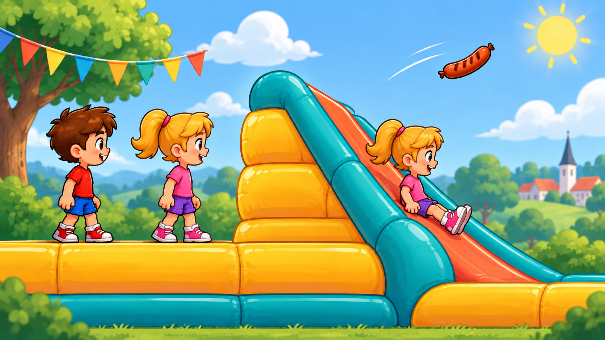

# Stilprøve 01 — Hop og Rul

Dato: 16. september 2026.



## Formål og status

Godkendt af arrangøren den 16. september 2026 som fast grafikreference:
“Dette billede er helt perfekt. Det er lige den stil jeg leder efter.”
Godkendelsen gælder den korrigerede version, stilproeve-01.png.

Den er en samlet illustration,
ikke færdige animationsbilleder eller et billede af den implementerede bane.
Spillets kode, fysik og originale PNG-filer er ikke ændret i denne grafikopgave.
Pigen vises to gange for at sammenligne neutral og siddende pose.

Retningen viser genkendelige figurer vendt mod højre, klare konturer,
gule hoppepuder, koralfarvet sliske med turkise sider og rolige grønne omgivelser.
Hoved- og kropsstørrelse bevares i den siddende pose.

Første generering blev rettet, fordi figurer og sliske var for frontvendte.
Den gemte version har tydelig højrevendt sidevisning og er nu valgt som
produktionsreference. Næste trin er separate figurbilleder og banemoduler.

## Fast grafikretning

- Brug det godkendte billede som visuel reference ved al ny billedproduktion.
- Bevar drengens og pigens ansigter, hår, tøjfarver og kropsproportioner.
- Figurerne vender mod højre langs banen, også når spilleren styrer tilbage.
- Bevar samme hoved- og kropsskala i stående, hoppende og siddende poser.
- Brug klare farvede konturer, bløde former, varme højlys og enkel skygge.
- Puder er gule/orange; slisker er koralfarvede med turkise oppustelige sider.
- Omgivelserne er grønne og roligere end figurer, banedele og flyvende farer.
- Animationer og gentagelige moduler tilpasses den eksisterende fysik.

## Visuel kontrol

- Billedet er 1672 × 941 pixels og kopieret uændret ind i projektet.
- Kontrolleret i stor visning og i browser ved 667 × 375: figurerne peger
  mod højre; pude, sliske, træ og pølse kan skelnes; den siddende pose har
  sammenlignelig hoved- og kropsskala med den stående.
- Stilprøven viser figurerne større end deres nuværende størrelse i spillet.
  Den erstatter derfor ikke en senere kontrol af separate sprites ved
  52 × 70 spilenheder eller af animation, kontaktankre og kollisionsfelter.
- Flagline og skyer vises som stillbilleder. Vind og bevægelse laves ved integration.
- Ingen spiltests er kørt, fordi denne opgave kun tilføjer illustration og noter.

## Kilder og værktøj

- Genereret med det indbyggede imagegen-værktøj; ingen CLI/API-fallback.
- Figurreference 1: ../../dreng_idle.png.
- Figurreference 2: ../../pige_idle.png.
- Første udkast: exec-49f9e05e-d08c-4c48-b3f4-4dcc25432ec9.png.
- Gemt slutbillede: stilproeve-01.png, kopieret uændret fra
  exec-7a59d937-2bb7-42b8-8ffa-c859702b2c20.png.

## Genereringsprompt

```text
Use case: stylized-concept.
Asset type: FIRST VISUAL STYLE SAMPLE for the Danish children's side-scrolling browser game "Aulum Byfest: Hop og Rul". One cohesive wide 16:9 illustrated scene, not finished game assets and not a sprite sheet.
Input images: Image 1 is the existing BOY character identity reference: brown spiky hair, red T-shirt, blue shorts, red and white sneakers. Image 2 is the existing GIRL character identity reference: blonde ponytail, pink T-shirt, purple shorts, pink and white sneakers. Preserve their recognizability, clothing colors, cheerful faces and child proportions. Ignore the checkerboard backgrounds. These are references, not images to paste unchanged.
Primary request: Establish a unified polished 2D cartoon art direction for an inflatable playground game for children aged 6–12. Clear silhouettes, crisp confident dark colored outlines, rounded forms, restrained soft cel shading, warm sunlight. Match characters and scenery in one consistent illustration style. Colorful and inviting without excessive tiny details.
Composition: Strict side-scroller elevation, movement from LEFT TO RIGHT, slight depth only in the inflatable surfaces. In the left portion show BOTH children standing separately in relaxed ready poses, full body and feet visible on one yellow/orange inflatable cushion. ALL characters face to the RIGHT: noses, gaze, chest, knees and toes point toward the right edge. A gentle three-quarter front-side view lets us still see their faces; no front-on poses and no looking or facing left. Neutral figures have arms comfortably by their sides.
In the right portion show a substantial higher cushion connecting to a STEEP inflatable slide descending down to the RIGHT, approximately 42 degrees, with a broad smooth coral-orange slide surface, teal inflated side rails, rounded seams, and a low padded landing. Show the SAME girl a second time as a separate POSE STUDY, seated halfway down this slide with legs and shoes extended down the slope to the RIGHT. This is a style-study repeat of the existing girl, not a third character identity. Her head, torso and limbs have exactly the same physical scale as the standing girl's; she is shorter only because she is seated. Her seat and legs make believable contact with the slide. Do not shrink, rotate a standing pose or hide her body behind the front rail. Clear visual separation between the standing pair and seated pose.
The cushions must look obviously inflatable: bulging rounded sides, soft level top, panel seams and gentle highlights; no rectangular solid blocks and no written labels. All playable ground is inflatable. Characters are large enough to judge direction and posture, each standing figure roughly 15 percent of the picture height.
Background: soft blue sky, a few fluffy clouds, a simple warm sun, softly layered green hills and one prominent recognizable tree with branching trunk and an organic leafy crown. A light festive bunting line with gently wind-curved colored pennants. Background has quieter contrast than characters and terrain. One recognizable small flying grilled sausage, with subtle motion strokes, isolated against clear sky near the course, roughly the length of a child's torso; no face on the sausage.
Avoid: text, headings, captions, logos, HUD, buttons, score counters, watermarks, checkerboards, photorealism, isometric or bird's-eye perspective, crouching/ducking/rolling poses, miniature seated figure, extra limbs, cropped feet, busy decorations. Keep breathing room between key subjects. Deliver only the complete landscape style-sample illustration.
```

## Rettelsesprompt brugt til det gemte billede

```text
Use case: precise-object-edit.
Asset type: corrected style sample for a SIDE-SCROLLING 2D children's game.
Reference image 1 is the first style sample. Preserve its character identities, clothing, warm friendly outlined cartoon style, yellow inflatable cushions, coral slide, teal inflatable rails, tree, clouds, sun, bunting and sausage. Correct the CAMERA VIEWPOINT and CHARACTER ORIENTATION, which are presently much too frontal.
The finished illustration must be a true SIDE ELEVATION, like looking at a playground from a fixed camera to its side. Horizontal ground surfaces are nearly horizontal lines in the image with just a very narrow strip of top visible. We see the SIDE WALL of the big cushion, not a large top surface viewed from above. The slide is a large triangular inflatable structure in side elevation, with a long straight diagonal upper surface descending from upper-left to lower-right at 42 degrees. No front-facing chute opening toward the viewer. No receding-to-camera perspective. This is essential so feet can follow a precise platform line in a side-scroller.
Correct BOTH standing figures: turn the WHOLE BODY to face SCREEN RIGHT, nose points right, chest projects right, both knees and BOTH shoe toe tips point unmistakably to the right edge. Arms can hang relaxed, one partly behind the torso. Show a front-side THREE-QUARTER PROFILE with a rightward projecting nose and clearly asymmetric visible eyes, almost a side view; do not keep the frontal symmetrical poses from the reference. Boy and girl stand on the horizontal upper edge of the yellow cushion. Both stand full body, with their feet actually touching that edge.
Correct the seated repeat of the girl: show her in RIGHT-FACING SIDE PROFILE, sitting down the diagonal slide with knees and both shoes extended toward lower-right. Her seat is on the slide contact line. Keep the SAME head, torso and limb size as the standing girl. Do not make a tiny slide rider. The near rail must be low enough not to hide her.
Recompose as needed for this consistent side-camera view, with the neutral boy and girl at the left and the steep descending slide at the right. Keep the children and inflatable equipment clearly separated from quieter background scenery. Preserve the wide 16:9 landscape frame. No text, no labels, no buttons, no ducking or rolling. No extra character identities. Do not change the art style. The result should read as RIGHTWARD MOTION, not children facing the audience.
```
